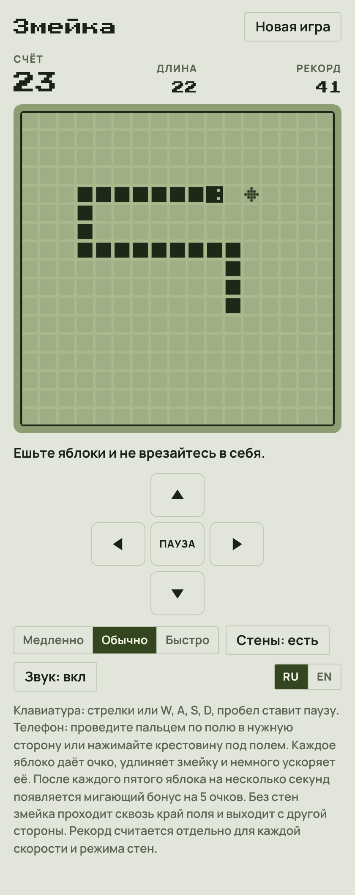
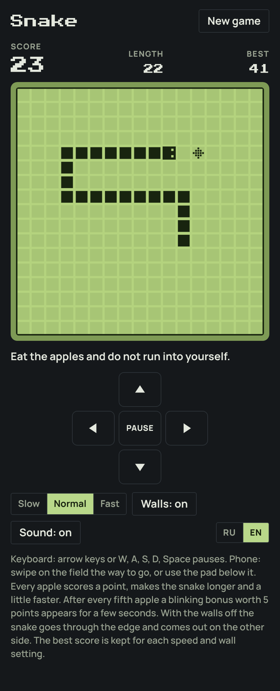

# Змейка

[English version](README.md)

Браузерная «Змейка» в стиле экрана старого монохромного телефона. Ведите змейку к яблокам, растите и не врезайтесь в себя.

**[Играть в браузере](https://posoxai.github.io/Snake/)**

  
  

Слева светлая тема с русским интерфейсом, справа тёмная с английским.

## Правила

- Змейка сама ползёт по полю 17 × 17. Вы только поворачиваете её.
- Каждое яблоко даёт очко, удлиняет змейку на клетку и немного ускоряет её.
- После каждого пятого яблока на 6 секунд появляется мигающий бонус на 5 очков.
- Игра кончается, когда змейка врезается в стену или в себя. Хвост на каждом шаге уползает, поэтому идти вплотную за своим хвостом безопасно.
- Игра выиграна, если змейка заняла всё поле.

## Настройки

- **Скорость:** медленно, обычно или быстро. В начале это 3, 5 и 8 клеток в секунду.
- **Стены:** без стен змейка проходит сквозь край поля и выходит с другой стороны.

Рекорд хранится отдельно для каждой скорости и режима стен. Если сменить их посреди игры, игра один раз переспросит, прежде чем сбросить счёт.

## Управление

- Клавиатура: стрелки или W, A, S, D. Пробел, P или Esc ставят паузу.
- Телефон: проведите пальцем по полю в нужную сторону или нажимайте крестовину под полем.
- Два быстрых поворота между шагами срабатывают оба, так что разворот в два нажатия получается.

Когда вы уходите со вкладки, игра сама встаёт на паузу. Незаконченная игра, рекорды и настройки хранятся в браузере игрока, после перезагрузки игра возвращается на паузе.

## Язык

Интерфейс на русском и английском. Русский включается сам, если он есть в списке языков браузера, иначе игра открывается на английском. Переключатель RU/EN запоминает выбор.

## Как запустить

Вся игра лежит в одном файле `index.html`. Сборка и зависимости не нужны.

- Локально: откройте `index.html` в браузере.
- По ссылке: игра опубликована через GitHub Pages по адресу https://posoxai.github.io/Snake/. Каждый коммит в `main` обновляет её автоматически.

Шрифты загружаются с Google Fonts. Без сети игра работает на системных шрифтах.

## Счётчик посещений

Опубликованная страница считает посещения через [GoatCounter](https://www.goatcounter.com/). По словам сервиса, он не ставит cookies и не хранит личных данных. Когда `index.html` открыт с диска, счётчик не работает.

## Авторство

Игру написал Claude, ИИ-ассистент компании Anthropic: логику, графику на canvas, звук и оформление страницы.

Правила взяты из классических «Змеек». Внешний вид навеян монохромным экраном телефона; рисунки и оформление этой версии свои.

Идея сделать браузерную версию принадлежит posoxAI.

## Лицензия

MIT. Полный текст в файле [LICENSE](LICENSE).
